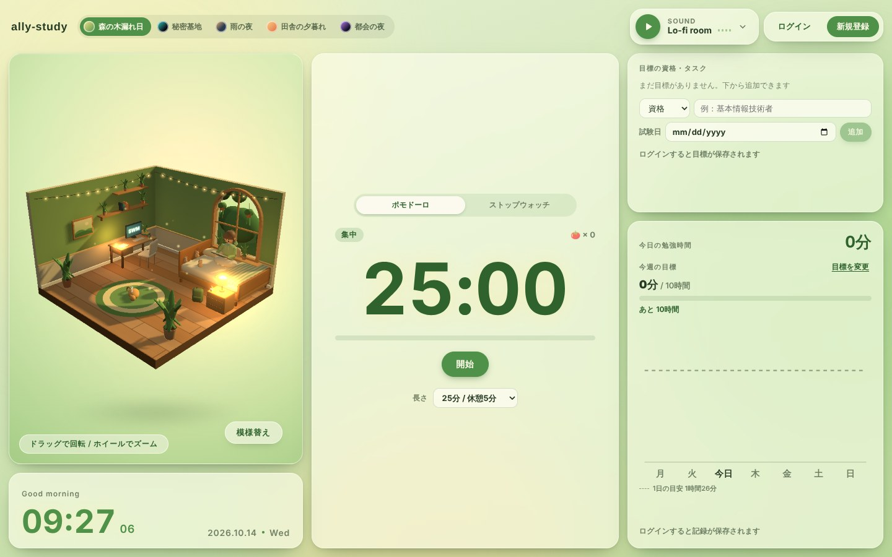
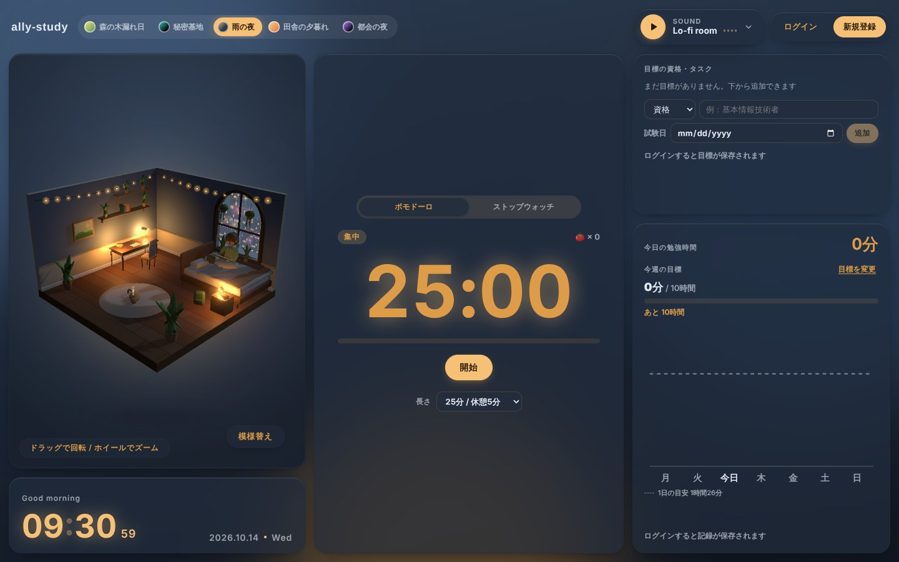
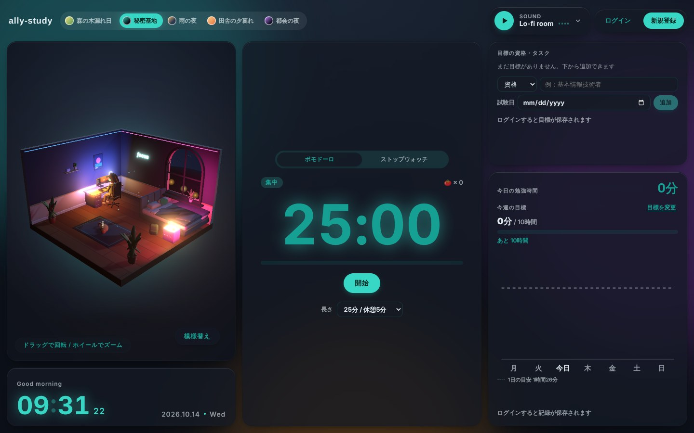
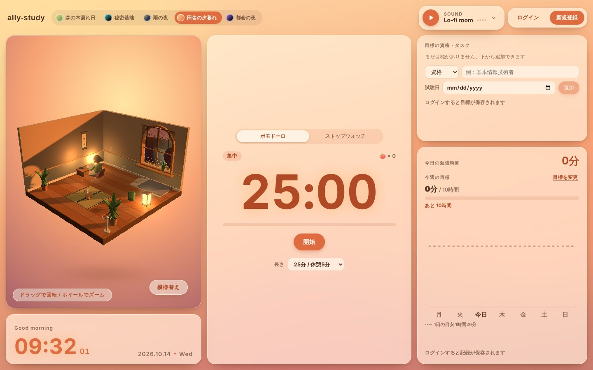
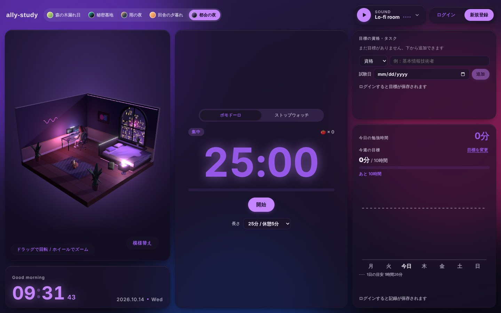
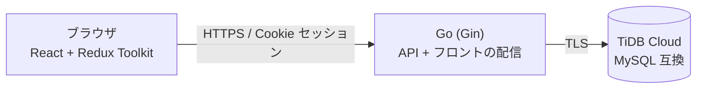

# ally-study

勉強などの自己研鑽のお供に、ブラウザで開いておく Web アプリです。
画面の 3D の部屋で住人が過ごし、BGM や環境音が流れるなか、勉強時間を記録できます。

**▶ 公開中： https://ally-study.onrender.com/**

> 無料プランで動かしているため、しばらくアクセスがないとサーバーが止まり、最初の表示に 1 分ほどかかることがあります。



テーマを切り替えると、部屋の家具・窓の外・画面全体の色がまとめて変わります。

| 雨の夜 | 秘密基地 |
|---|---|
|  |  |
| **田舎の夕暮れ** | **都会の夜** |
|  |  |

## 主な機能

| 機能 | 内容 |
|---|---|
| 3D の部屋 | 住人と家具のある部屋を 3D で表示。模様替えモードで家具をドラッグして動かせる |
| 模様替え | 家具の出し入れ（バッグ）・壁紙・住人の切り替え。ログインユーザーごとに保存 |
| テーマ | 森の木漏れ日・秘密基地・雨の夜・田舎の夕暮れ・都会の夜。部屋の家具と画面全体の色が連動して切り替わる |
| サウンド | BGM（Lo-fi・ピアノ・オルゴールなど）と環境音（雨・焚き火・波・小鳥など）を選んで重ねて流せる |
| 勉強タイマー | ポモドーロ / ストップウォッチで勉強時間を記録 |
| 学習記録 | 1 週間の勉強時間のグラフ、週の目標、資格・タスクの期限を表示 |
| アカウント | ユーザー名＋パスワードで新規登録・ログイン・退会（メールアドレス不要） |
| アクセス解析 | 画面を開いた・音を流したなどの操作を、ブラウザごとの匿名 ID で記録。管理者だけが見られる管理画面（`/admin`）で日別の集計をグラフで確認でき、生ログは JSON Lines で書き出せる |

## 技術スタック

| 分類 | 使用技術 |
|---|---|
| フロントエンド | React 19 / TypeScript / Vite |
| 状態管理・通信 | Redux Toolkit / RTK Query |
| 3D 表示 | three.js / React Three Fiber / drei |
| テスト（フロント） | Jest / Testing Library |
| バックエンド | Go / Gin |
| データベース | MySQL 8.4（本番は MySQL 互換の TiDB Cloud） |
| API 定義 | OpenAPI 3（Go・TypeScript の型をスキーマから自動生成） |
| 開発環境 | Docker / Docker Compose |
| CI | GitHub Actions |
| 公開 | Render / TiDB Cloud Starter |
| 開発フロー | GitHub flow（Issue ごとにブランチを切り、PR でマージ） |

## 構成



- 本番では Go のサーバーがビルド済みのフロントも配るため、フロントと API が同じドメインになり、Cookie をそのまま使えます
- API は `api/openapi.yaml` を正として、Go のサーバー側の型（oapi-codegen）とフロントの型（openapi-typescript）を生成しています
- バックエンドは `handler`（HTTP）→ `service`（業務ロジック）→ `repository`（DB）の層に分けています

## 工夫した点

- **API の型をスキーマから生成**：OpenAPI を先に書き、フロントとバックエンドで型のずれが起きないようにした
- **セキュリティ対策**：パスワードの bcrypt ハッシュ化、Cookie の `HttpOnly` / `SameSite` / `Secure`、CSRF 対策、ログイン・新規登録の回数制限、セキュリティヘッダー（CSP など）。詳細は [docs/deploy.md](docs/deploy.md#セキュリティ対策の一覧)
- **CI で品質を確認**：PR ごとに Lint・テスト・ビルドに加え、`npm audit` と `govulncheck` でライブラリの脆弱性もチェック
- **個人情報を増やさない設計**：メールアドレスは集めず、アクセス解析は匿名 ID で記録。退会するとアカウントのデータをすべて削除し、解析イベントからもユーザーとの結びつきを外す
- **音源ファイルに頼らないサウンド**：BGM や環境音をコードで生成し、複数を重ねて音量を調整できるようにした

## ディレクトリ構成

```
ally-study/
├── api/openapi.yaml        # API の定義（ここから型を生成）
├── backend/                # Go（Gin）の API サーバー
│   ├── cmd/server/         # エントリーポイント
│   ├── db/migrations/      # DB のマイグレーション
│   ├── db/analytics/       # アクセス解析用のマイグレーション
│   └── internal/           # handler / service / repository / middleware など
├── frontend/               # React のフロントエンド
│   └── src/features/       # 機能ごとのコード（admin / analytics / auth / room / sound / study / theme）
├── docs/deploy.md          # 公開（デプロイ）の手順とセキュリティ対策
├── docker-compose.yml      # ローカル開発用（MySQL + マイグレーション + API）
├── Dockerfile              # 本番用（フロントと API を 1 つのイメージに）
└── render.yaml             # Render の設定
```

## ローカルでの起動

必要なもの：Docker、Node.js 22

```bash
# 1. DB と API サーバーを起動（http://localhost:8080）
docker compose up --build

# 2. 別のターミナルでフロントを起動（http://localhost:5173）
cd frontend
npm install
npm run dev
```

開発中は Vite が `/api` へのリクエストを API サーバーに転送します。

## 開発用コマンド

| やりたいこと | コマンド |
|---|---|
| フロントのテスト | `cd frontend && npm test` |
| フロントの Lint | `cd frontend && npm run lint` |
| フロントの API 型を生成 | `cd frontend && npm run gen:api` |
| バックエンドのテスト | `cd backend && go test ./...` |
| バックエンドの API コードを生成 | `cd backend && go generate ./...` |
| 停止 | `docker compose down`（DB のデータも消す場合は `-v`） |

## ドキュメント

- [公開（デプロイ）の手順](docs/deploy.md)
- [フロントエンドについて](frontend/README.md)

## ライセンス

[MIT](LICENSE)
